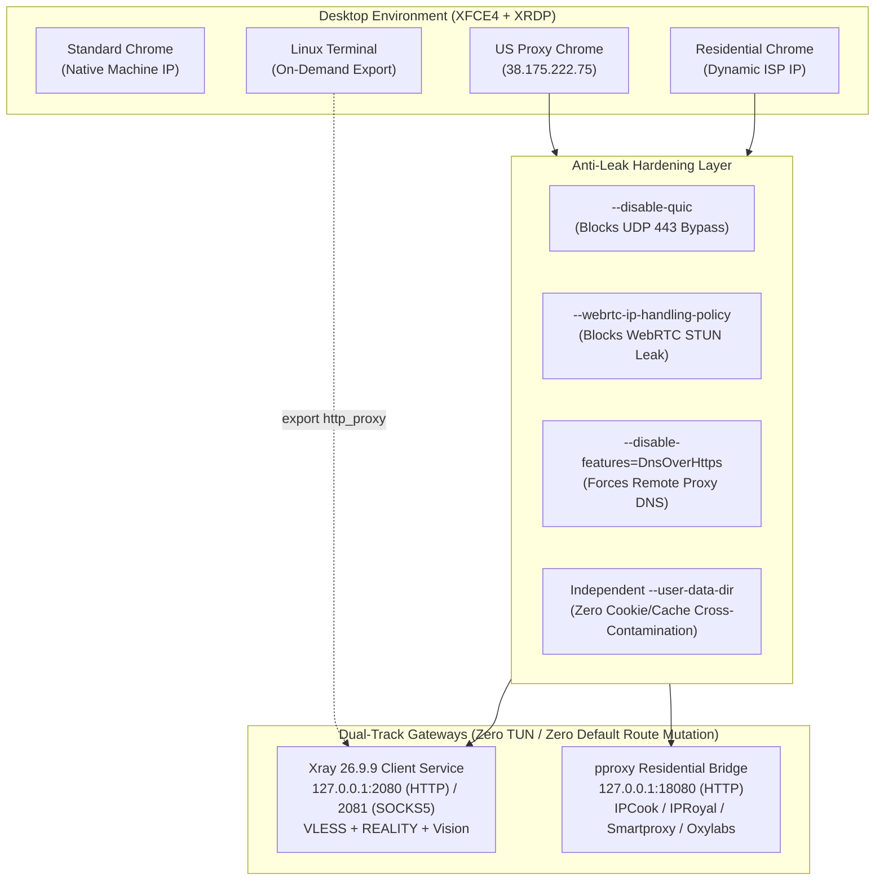

# VPS Chrome Proxy & Anti-Leak Gateway Engine

[](https://opensource.org/licenses/MIT)
[](https://www.python.org/downloads/)
[-green.svg)]()
[]()

> Automated Provisioning Engine for Anti-Leak Proxy-Isolated Chrome Browsers & Multi-Gateway Tunnels on Linux VPS & LXC Instances.

[English](./README.md) | [中文说明](./README_zh.md)

---

## 🌟 Architecture & Key Highlights

`vps-chrome-proxy` is built for developers and AI agents who need **production-grade remote desktop isolation**, **zero route mutations**, and **strict privacy protections against real IP leaks**.



### Why This Engine?
1. **Zero Disconnection Risk**: Does not alter system routing tables or spin up intrusive TUN devices. SSH (`22`) and XRDP (`3389`) sessions remain completely undisturbed.
2. **Dual-Track Proxying**:
   - **Track A (VLESS + REALITY + Vision)**: High-performance encrypted tunnel via native Xray for LLMs (Claude Code, OpenAI, GitHub).
   - **Track B (Dynamic Residential Chain Bridge)**: Chain forwarding to residential proxies with one-click desktop region switching.
3. **Hardened Anti-Leak Chrome**:
   - WebRTC STUN leaks eliminated.
   - QUIC UDP 443 proxy bypass blocked.
   - Local DNS leaks blocked.
   - Root execution in XRDP safely adapted with `--no-sandbox` and `--disable-dev-shm-usage`.
4. **Local Cheat Sheet Generation**: Automatically writes a clean summary text (`/root/Desktop/PROXY_CHEAT_SHEET.txt`) for instant `cat` viewing.

---

## 🚀 Quick Start

### 1. Requirements
* Linux OS (Ubuntu 20.04/22.04+, Debian 11/12+).
* Python 3.8+.
* Target machine can be **Localhost** or **Remote Host over SSH** (e.g. LXC container created via `vps-lxc-creator`).

### 2. Basic Inspection
```bash
python3 scripts/vps_chrome_proxy.py --check-env
```

### 3. Deploy VLESS Proxy & Anti-Leak Chrome (Localhost)
```bash
python3 scripts/vps_chrome_proxy.py \
  --all-in-one \
  --add-vless "vless://uuid@relay-ip:port?security=reality&encryption=none&pbk=...&fp=chrome&type=tcp&flow=xtls-rprx-vision&sni=...&sid=..." \
  --http-port 2080 \
  --socks-port 2081 \
  --chrome-name "US Proxy Chrome"
```

### 4. Deploy Over SSH (Remote LXC / VPS)
```bash
python3 scripts/vps_chrome_proxy.py \
  --ssh-host 192.168.1.100 \
  --ssh-port 22 \
  --ssh-user root \
  --ssh-pass "TargetPassword" \
  --all-in-one \
  --add-vless "vless://..."
```

---

## 📋 Terminal On-Demand Proxy Usage

No `.bashrc` pollution. Enable or disable directly in your active shell:

```bash
# Enable Proxy
export http_proxy=http://127.0.0.1:2080
export https_proxy=http://127.0.0.1:2080
export all_proxy=http://127.0.0.1:2080

# Verify Current IP
curl https://api.ipify.org

# Disable Proxy (Return to Native Server IP)
unset http_proxy https_proxy all_proxy
```

---

## 📖 Local Cheat Sheet

Check current status and configuration on the target machine anytime:
```bash
cat /root/Desktop/PROXY_CHEAT_SHEET.txt
```

---

## 🤖 Multi-Agent Compatibility

| Agent Platform | Adapter Location | Description |
| :--- | :--- | :--- |
| **Antigravity (AGY)** | `SKILL.md`, `.agents/skills/vps-chrome-proxy/` | Full AGY skill specification |
| **Claude Code** | `claude/system_prompt.en.md` | Claude Code prompt adapter |
| **OpenAI GPTs** | `openai/gpt_instructions.en.md` & `actions_schema.json` | Custom GPT Action schema |

---

## 📄 License

Distributed under the [MIT License](./LICENSE). Copyright (c) 2026 arifulcrypto.
